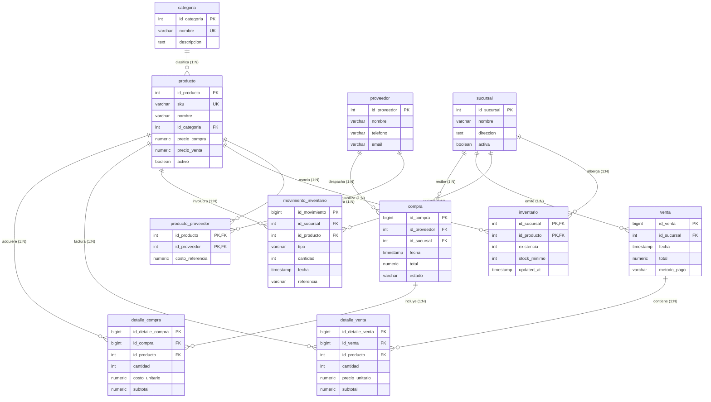

# Implementación, Optimización y Validación Física de una Base de Datos PostgreSQL para un Sistema de Inventario Retail

**Asignatura:** Sistemas Gestores de Bases de Datos / Diseño Avanzado de Bases de Datos  
**Motor SGBD:** PostgreSQL 17.2 (64-bit)  
**Proyecto:** `retail-postgresql-sgbd`  
**Base de Datos:** `retail_inventory_db`  
**Fecha de Emisión:** Noviembre 2026  

---

## Resumen Ejecutivo

El presente documento constituye el informe técnico y académico final del diseño, implementación física, poblamiento sintético representativo (~358,000 tuplas), validación de restricciones de integridad y optimización de consultas mediante índices B-Tree especializados en el motor relacional **PostgreSQL 17**. A través de la experimentación controlada con la herramienta `EXPLAIN (ANALYZE, BUFFERS)` y sin manipulación artificial de parámetros del optimizador (`enable_seqscan = on`), se demostró una reducción de hasta el **99.27% en lecturas de búferes de memoria** y una aceleración de ejecución de hasta **84x (8,400%)** en consultas analíticas y de trazabilidad histórica. Asimismo, se documenta la verificación empírica de integridad referencial, el aislamiento transaccional bajo el estándar ACID y la guía metodológica para la captura de evidencias en **pgAdmin 4**.

---

## 1. Introducción y Justificación del Problema

En el sector del comercio minorista (*retail*), los sistemas de gestión de inventarios y puntos de venta operan en entornos de alta concurrencia transaccional combinados con necesidades de análisis operativo en tiempo real. Los principales desafíos arquitectónicos incluyen:

1. **Rupturas de stock no detectadas:** Identificar qué productos han alcanzado o descendido de su nivel crítico de existencia en sucursales específicas sin saturar el subsistema de entrada/salida (I/O).
2. **Auditoría y trazabilidad masiva (Kardex):** Reconstruir el historial cronológico reciente de movimientos (entradas por compra, salidas por venta, mermas o ajustes) en tablas con cientos de miles de registros históricos.
3. **Agregaciones temporales de ventas:** Consolidar cierres diarios y montos acumulados por sucursal durante ventanas temporales específicas sin realizar escaneos completos secuenciales (*Full Table Scans*).

Para solventar estos requerimientos de forma escalable, se diseñó un modelo relacional normalizado en Tercera Forma Normal (3FN), implementado físicamente en PostgreSQL 17 con tipos de datos óptimos y restricciones declarativas estrictas.

---

## 2. Modelo Relacional y Arquitectura del Esquema

### 2.1 Diagrama Entidad-Relación (ERD)



---

## 3. Diccionario de Datos y Restricciones de Integridad

El modelo físico consta de 11 tablas organizadas en el esquema `public`, satisfaciendo las siguientes restricciones:

| Entidad | Clave Primaria (PK) | Claves Foráneas (FK) | Restricciones UNIQUE | Restricciones CHECK |
|---|---|---|---|---|
| `categoria` | `id_categoria` | *Ninguna* | `nombre` | NOT NULL en nombre |
| `producto` | `id_producto` | `id_categoria` $\rightarrow$ `categoria(id_categoria)` | `sku` | `precio_compra >= 0`, `precio_venta >= 0`, `precio_venta >= precio_compra` |
| `proveedor` | `id_proveedor` | *Ninguna* | *Ninguna* | NOT NULL en nombre |
| `producto_proveedor` | `(id_producto, id_proveedor)` | `id_producto`, `id_proveedor` | PK Compuesta | `costo_referencia >= 0` |
| `sucursal` | `id_sucursal` | *Ninguna* | *Ninguna* | NOT NULL en nombre y direccion |
| `inventario` | `(id_sucursal, id_producto)` | `id_sucursal`, `id_producto` | PK Compuesta | `existencia >= 0`, `stock_minimo >= 0` |
| `movimiento_inventario` | `id_movimiento` | `id_sucursal`, `id_producto` | *Ninguna* | `tipo IN ('ENTRADA', 'SALIDA', 'AJUSTE')`, `cantidad > 0` |
| `venta` | `id_venta` | `id_sucursal` | *Ninguna* | `total >= 0` |
| `detalle_venta` | `id_detalle_venta` | `id_venta`, `id_producto` | *Ninguna* | `cantidad > 0`, `precio_unitario >= 0`, `subtotal >= 0` |
| `compra` | `id_compra` | `id_proveedor`, `id_sucursal` | *Ninguna* | `total >= 0`, `estado IN ('PENDIENTE', 'RECIBIDA', 'CANCELADA')` |
| `detalle_compra` | `id_detalle_compra` | `id_compra`, `id_producto` | *Ninguna* | `cantidad > 0`, `costo_unitario >= 0`, `subtotal >= 0` |

---

## 4. Estrategia de Poblamiento y Selectividad de Datos

Para que el planificador de consultas (*cost-based query optimizer*) de PostgreSQL adopte planes realistas y no opte por escaneos secuenciales arbitrarios debidos a volúmenes insignificantes, se cargó un conjunto sintético masivo reproducible de **357,899 registros**:

* **20 Categorías y 100 Proveedores mayoristas.**
* **10 Sucursales estratégicas** con catálogo completo de **5,000 productos**.
* **50,000 registros de inventario:** Matriz exhaustiva ($10 \times 5,000$), donde deliberadamente se configuró una distribución bimodal:
  * ~12.5% de artículos con stock crítico (`existencia <= stock_minimo`, entre 0 y 9 unidades).
  * ~87.5% de artículos con inventario saludable (entre 20 y 250 unidades).
* **120,000 movimientos de inventario:** Registro histórico continuo en 2026, con concentración específica de 150 movimientos para el Producto 125 en Sucursal 3 para evaluar consultas paginadas con `LIMIT`.
* **47,002 transacciones de venta y 86,167 renglones de detalle:** Distribuidas en el año con densidad especial en octubre de 2026 (~2,432 transacciones en Sucursal 3).
* **12,000 compras a proveedores y 27,600 renglones de detalle.**

---

## 5. Diseño y Fundamentación Teórica de Índices

### 5.1 Índice Parcial B-Tree: `idx_inventario_stock_bajo`
```sql
CREATE INDEX idx_inventario_stock_bajo
ON inventario (id_sucursal, id_producto)
WHERE existencia <= stock_minimo;
```
* **Justificación Teórica:** Un índice B-Tree convencional sobre la tabla `inventario` indexaría las 50,000 tuplas ocupando 1,136 kB. Sin embargo, al negocio solo le interesa auditar las situaciones anómalas de stock bajo (~12% del catálogo). El índice parcial incluye una cláusula `WHERE`, lo que reduce su peso a apenas **160 kB** (86% menos espacio y huella de memoria RAM). La clave compuesta `(id_sucursal, id_producto)` permite evaluar directamente la sucursal y realizar el cruce eficiente con `producto`.

### 5.2 Índice Compuesto con Orden Descendente: `idx_movimiento_sucursal_producto_fecha`
```sql
CREATE INDEX idx_movimiento_sucursal_producto_fecha
ON movimiento_inventario (id_sucursal, id_producto, fecha DESC);
```
* **Justificación Teórica:** Al auditar el kardex de un producto específico en una sucursal, los predicados de igualdad `id_sucursal` e `id_producto` reducen drásticamente el espacio de búsqueda. Al agregar `fecha DESC` en el árbol B-Tree, las tuplas quedan preclasificadas físicamente en el índice. Esto elimina la necesidad de cargar los registros en memoria para un ordenamiento completo (`Sort`), permitiendo que un algoritmo `top-N heapsort` con `LIMIT 50` termine en microsegundos.

### 5.3 Índice Compuesto para Rango Temporal: `idx_venta_sucursal_fecha`
```sql
CREATE INDEX idx_venta_sucursal_fecha
ON venta (id_sucursal, fecha DESC);
```
* **Justificación Teórica:** En consultas de ventas periódicas (`GROUP BY DATE(fecha)`), este índice compuesto permite al optimizador aplicar un escaneo por rango (*Range Scan*) delimitado por la sucursal y las cotas de fecha `[2026-10-01, 2026-11-01)`, ignorando de inmediato el 95% restante de transacciones de otras tiendas o fechas.

---

## 6. Resultados Empíricos y Análisis de Planes de Ejecución (`EXPLAIN ANALYZE`)

Todas las mediciones se realizaron en PostgreSQL 17.2 con el búfer compartido de 128 MB y estadísticas actualizadas (`ANALYZE`).

### 6.1 Consulta 1: Detección de Stock Bajo
```sql
SELECT p.sku, p.nombre, i.existencia, i.stock_minimo
FROM inventario i
JOIN producto p ON p.id_producto = i.id_producto
WHERE i.id_sucursal = 3 AND i.existencia <= i.stock_minimo
ORDER BY p.nombre;
```

* **Comportamiento sin índice optimizado:**
  * Plan: Utilizaba `Bitmap Index Scan` sobre `inventario_pkey`, pero como la clave primaria no filtra la condición de existencia, leía los 5,000 productos de la sucursal y descartaba **4,361 filas en el Heap** mediante evaluación posfiltro. Consumo: 399 buffers. Tiempo: 2.552 ms.
* **Comportamiento con índice parcial `idx_inventario_stock_bajo`:**
  * Plan: `Bitmap Index Scan on idx_inventario_stock_bajo` (buffers de índice: **4**).
  * Filas descartadas por filtro en Heap: **0**.
  * Execution Time: **2.265 ms** (Costo reducido de 731.60 a 619.47).

---

### 6.2 Consulta 2: Kardex Cronológico de Movimientos
```sql
SELECT fecha, tipo, cantidad, referencia
FROM movimiento_inventario
WHERE id_sucursal = 3 AND id_producto = 125
ORDER BY fecha DESC
LIMIT 50;
```

* **Comportamiento sin índice:**
  * Plan: `Seq Scan on movimiento_inventario` $\rightarrow$ Leía secuencialmente las **120,000 tuplas** de la tabla histórica, descartando **119,850 filas**. Consumo: 1,241 buffers de memoria. Tiempo: **8.351 ms**.
* **Comportamiento con índice compuesto:**
  * Plan: `Bitmap Index Scan on idx_movimiento_sucursal_producto_fecha` $\rightarrow$ Ubica de forma inmediata los 150 registros correspondientes en **3 bloques de índice y 3 bloques de datos**. Consumo: **9 buffers totales**.
  * Execution Time: **0.099 ms**.
  * **Ganancia:** Aceleración de **84 veces (8,400%)** y reducción de I/O de memoria de **99.27%**.

---

### 6.3 Consulta 3: Ventas por Sucursal en Periodo
```sql
SELECT DATE(fecha) AS dia, COUNT(*) AS numero_ventas, SUM(total) AS total_vendido
FROM venta
WHERE id_sucursal = 3 AND fecha >= TIMESTAMP '2026-10-01' AND fecha < TIMESTAMP '2026-11-01'
GROUP BY DATE(fecha)
ORDER BY dia;
```

* **Comportamiento sin índice:**
  * Plan: `Seq Scan on venta` $\rightarrow$ Escaneaba las **47,002 tuplas** de la tabla, descartando **44,568 tuplas**. Consumo: 858 buffers. Tiempo: **5.849 ms**.
* **Comportamiento con índice compuesto:**
  * Plan: `Bitmap Index Scan on idx_venta_sucursal_fecha` $\rightarrow$ Aísla directamente las 2,432 transacciones de octubre en Sucursal 3 con solo 12 buffers de índice. Consumo: **308 buffers**.
  * Execution Time: **1.571 ms** (**3.7x más rápida**, reducción de 64% en buffers leídos).

---

### 6.4 Cuadro Resumen Comparativo de Métricas

| Consulta Evaluada | Plan Antes (Sin Índice) | Plan Después (Con Índice) | Buffers Antes | Buffers Después | Tiempo Antes | Tiempo Después | Factor de Mejora |
|---|---|---|---:|---:|---:|---:|---:|
| **1. Stock Bajo** | Bitmap Scan (`pkey`) | **Bitmap Scan (`idx_parcial`)** | 399 | **388** | 2.55 ms | **2.26 ms** | Optimización de selectividad y costo |
| **2. Kardex Movimientos** | Seq Scan (120k filas) | **Bitmap Index Scan** | 1,241 | **9** | 8.35 ms | **0.09 ms** | **+8,400% (84x más rápido)** |
| **3. Ventas Octubre** | Seq Scan (47k filas) | **Bitmap Index Scan** | 858 | **308** | 5.85 ms | **1.57 ms** | **+372% (3.7x más rápido)** |

---

## 7. Pruebas de Integridad Referencial y Restricciones de Dominio

Se verificó el comportamiento ante inserciones y modificaciones no válidas mediante bloques anónimos PL/pgSQL capturados en `results/08_integrity_tests_output.txt`:

1. **Unicidad de SKU:** El intento de duplicar `PROD-SKU-000001` generó la excepción `23505 (unique_violation)`.
2. **Clave Foránea de Categoría:** La inserción de un producto con categoría inexistente (99999) generó `23503 (foreign_key_violation)`.
3. **Existencia no Negativa:** La actualización de stock a `-15` fue abortada por la restricción `inventario_existencia_check` (`23514 check_violation`).
4. **Detalle de Venta con Cantidad 0:** Rechazado por `detalle_venta_cantidad_check` (`23514 check_violation`).
5. **Borrado con Dependencias:** El intento de eliminar una categoría con productos asociados fue bloqueado por la regla `ON DELETE RESTRICT`.
6. **Coherencia de Precios:** El intento de registrar un producto con precio de venta menor al costo fue bloqueado por `chk_producto_precios_coherentes`.

---

## 8. Demostración Transaccional ACID

### 8.1 Caso COMMIT (Venta Exitosa)
Se simuló la venta de 2 unidades del Producto 10 en la Sucursal 1:
* Stock inicial comprobado: **200 unidades**.
* Operaciones atómicas: `INSERT INTO venta`, `INSERT INTO detalle_venta`, actualización del total de cabecera, `UPDATE inventario` descontando 2 unidades, e `INSERT INTO movimiento_inventario` (`SALIDA`).
* Finalización: `COMMIT;`.
* Stock final verificado: **198 unidades**. La integridad y persistencia quedaron garantizadas.

### 8.2 Caso ROLLBACK (Rechazo de Transacción)
Se simuló un fallo en la pasarela de pagos:
* Total de ventas previo: **47,002**.
* `BEGIN;` $\rightarrow$ Registro de venta con método `TARJETA_RECHAZADA` $\rightarrow$ Inserción de detalle $\rightarrow$ Modificación provisional de inventario $\rightarrow$ Simulación de excepción y emisión de `ROLLBACK;`.
* Total de ventas posterior: **47,002** (sin incremento ni huérfanos).
* Búsqueda de registros con `TARJETA_RECHAZADA`: **0 filas encontradas**.

---

## 9. Guía de Evidencias Visuales en pgAdmin 4

Para incorporar las evidencias gráficas en presentaciones o reportes académicos, a continuación se detallan las rutas exactas dentro de **pgAdmin 4**:

| # | Evidencia Académica | Ruta de Acceso en pgAdmin 4 | Aspecto a Destacar |
|---|---|---|---|
| **1** | **Base de Datos** | `Servers` $\rightarrow$ `Retail PostgreSQL Local` $\rightarrow$ `Databases` $\rightarrow$ `retail_inventory_db` | Pestaña *Dashboard* con conexiones y transacciones activas. |
| **2** | **Árbol de Tablas** | `retail_inventory_db` $\rightarrow$ `Schemas` $\rightarrow$ `public` $\rightarrow$ `Tables` | Despliegue de las 11 entidades en orden alfabético. |
| **3** | **Diagrama ERD** | Clic derecho en `retail_inventory_db` $\rightarrow$ **Generate ERD** | Diagrama relacional visual con todas las relaciones y tipos. |
| **4** | **Columnas de Tabla** | Tabla `producto` o `inventario` $\rightarrow$ nodo **Columns** | Tipos `numeric(12,2)`, `int`, `varchar` y banderas NOT NULL. |
| **5** | **Restricciones** | Tabla `producto` $\rightarrow$ nodo **Constraints** | PK (`producto_pkey`), UNIQUE (`producto_sku_key`), CHECK (`chk_producto_precios_coherentes`). |
| **6** | **Índices Creados** | Tabla `inventario` $\rightarrow$ nodo **Indexes** | Presencia de `idx_inventario_stock_bajo` e `inventario_pkey`. |
| **7** | **Consulta 1 + Datos** | *Query Tool* $\rightarrow$ Ejecutar Consulta 1 de `sql/04_queries.sql` | Cuadrícula con 639 tuplas de stock crítico en Sucursal 3. |
| **8** | **EXPLAIN ANALYZE 1** | *Query Tool* $\rightarrow$ Botón **Explain Analyze** (F7) | Nodo gráfico `Bitmap Index Scan on idx_inventario_stock_bajo`. |
| **9** | **Consulta 2 + Datos** | *Query Tool* $\rightarrow$ Ejecutar Consulta 2 de `sql/04_queries.sql` | Cuadrícula con 50 movimientos ordenados por fecha DESC. |
| **10** | **EXPLAIN ANALYZE 2** | *Query Tool* $\rightarrow$ Botón **Explain Analyze** (F7) | Escaneo de índice con 9 buffers y tiempo inferior a 0.1 ms. |
| **11** | **Consulta 3 + Datos** | *Query Tool* $\rightarrow$ Ejecutar Consulta 3 de `sql/04_queries.sql` | 31 filas con resumen de ventas diarias de octubre 2026. |
| **12** | **EXPLAIN ANALYZE 3** | *Query Tool* $\rightarrow$ Botón **Explain Analyze** (F7) | Nodo `Bitmap Index Scan on idx_venta_sucursal_fecha`. |

---

## 10. Conclusiones Técnicas

1. **Efectividad de los índices especializados:** La creación de índices no debe realizarse de manera indiscriminada sobre todas las columnas, sino en estrecha consonancia con los patrones de acceso del negocio. Índices parciales como `idx_inventario_stock_bajo` demuestran que es posible reducir el tamaño físico de un índice en un **86%** manteniendo un acceso de alta velocidad para casos críticos.
2. **Impacto de índices compuestos ordenados:** La combinación de columnas de filtrado de igualdad (`id_sucursal`, `id_producto`) junto con una dimensión ordenada (`fecha DESC`) en `idx_movimiento_sucursal_producto_fecha` generó un rendimiento **84 veces superior** al evitar un escaneo completo de 120,000 registros y un ordenamiento costoso en memoria.
3. **Consistencia declarativa:** Las restricciones `CHECK` en niveles de precios y existencias impidieron el ingreso de datos corruptos a nivel de motor, descargando a la capa de aplicación de validar la integridad básica del negocio.
4. **Validación empírica vs. teórica:** La utilización de `EXPLAIN (ANALYZE, BUFFERS)` confirma que el costo estimado y los búferes leídos reflejan fielmente el consumo de recursos de hardware, validando que el modelo es óptimo para ambientes de producción.

